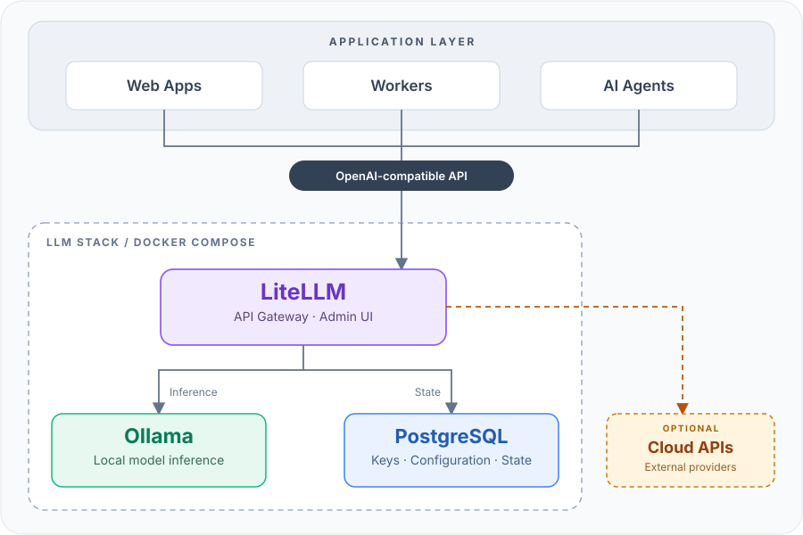

# LLM Stack

A self-hosted LLM stack with a unified OpenAI-compatible API, local model inference, and cloud provider integration. Powered by Docker Compose.

## Architecture



PostgreSQL stores gateway state, virtual keys, users and model configuration. All three services run in one Compose project.

## Quick start

Requires Docker Engine and Docker Compose v2. CPU inference is the default.

```sh
cp .env.example .env
```

Generate three independent secrets using `openssl rand -hex 32`. Set POSTGRES_PASSWORD, LITELLM_MASTER_KEY (prefix with sk-), and LITELLM_SALT_KEY. Keep the database password hexadecimal to avoid URL escaping issues.

```sh
docker compose config --quiet
docker compose up -d
docker compose ps
docker compose exec ollama ollama pull qwen3:4b
```

Open http://localhost:4000/ui. Use the default admin login and master key (see [LiteLLM UI documentation](https://docs.litellm.ai/docs/proxy/ui)).

Register an Ollama chat model with alias content-fast, provider model ollama_chat/qwen3:4b and API base http://ollama:11434. Create a virtual API key restricted to the alias. Set LLM_API_KEY in your shell to that key.

```sh
curl http://localhost:4000/v1/chat/completions \
  -H "Authorization: Bearer $LLM_API_KEY" \
  -H 'Content-Type: application/json' \
  -d '{"model":"content-fast","messages":[{"role":"user","content":"Write a short movie review title."}]}'
```

Cloud models can be added separately through the UI. Model weights are not downloaded automatically.

## Dokploy

1. Create a Docker Compose application (not Docker Stack) from this repository, using branch `master` and path `./docker-compose.yml`.
2. Copy the complete environment block below into the Environment UI and generate the three required secrets.
3. Enable **Isolated Deployments** in the Compose settings. Dokploy creates a project-specific network and attaches Traefik to it. Keep the explicit backend network; do not attach PostgreSQL or Ollama to the shared `dokploy-network`.
4. Create a DNS record pointing your chosen hostname to the server. In **Domains → Add Domain**, select service `litellm`, host (for example `llm.example.com`), path `/`, container port `4000`, HTTPS enabled, and Let's Encrypt as certificate provider. Do not configure Advanced → Ports.
5. Use **Preview Compose** to verify network membership, routing to LiteLLM port 4000, no published PostgreSQL/Ollama ports and loopback-only LiteLLM host binding. Deploy or redeploy after domain changes.
6. Pull models using the Ollama container terminal, then visit `https://llm.example.com/ui`. The application API base URL is `https://llm.example.com/v1`.

See [Dokploy Domains](https://docs.dokploy.com/docs/core/docker-compose/domains) and [Isolated Deployments](https://docs.dokploy.com/docs/core/docker-compose/utilities).

### Environment variables

Copy this entire block into **Dokploy → Environment**. Fill in the three empty required secrets before deployment. All other values are optional defaults.

```dotenv
POSTGRES_PASSWORD=
LITELLM_MASTER_KEY=
LITELLM_SALT_KEY=

LITELLM_PORT=4000

OLLAMA_NUM_PARALLEL=1
OLLAMA_MAX_LOADED_MODELS=1

OLLAMA_CPUS=0
OLLAMA_MEMORY=0

LITELLM_CPUS=0
LITELLM_MEMORY=0
```

#### Generate secrets

Run each command independently in your terminal and paste its output into the matching environment variable.

**POSTGRES_PASSWORD**

```sh
openssl rand -hex 32
```

**LITELLM_MASTER_KEY**

```sh
printf 'sk-%s\n' "$(openssl rand -hex 32)"
```

**LITELLM_SALT_KEY**

```sh
openssl rand -hex 32
```

Keep these secrets stable across redeployments and store them securely. Never commit populated environment files. The host port variable does not change the internal LiteLLM port (4000) used by Dokploy domain routing.

## Resource limits

Optional limits can be configured in the local .env file or Dokploy Environment UI. All default to `0` (unlimited).

| Variable | Default | Example values |
| --- | --- | --- |
| OLLAMA_CPUS | 0 | 2, 4, 8 |
| OLLAMA_MEMORY | 0 | 20g, 30g, 40g |
| LITELLM_CPUS | 0 | 0.5, 1, 2 |
| LITELLM_MEMORY | 0 | 512m, 2g, 4g |

For example:

```dotenv
OLLAMA_CPUS=8
OLLAMA_MEMORY=40g
LITELLM_CPUS=2
LITELLM_MEMORY=4g
```

CPU values represent logical CPU capacity; fractional values are supported. Memory uses Docker size suffixes (e.g. `m` and `g`). These are illustrative limits, not minimum requirements or reserved resources. PostgreSQL has no explicit container resource limits. Leave enough capacity for the host and other services. A memory limit below the model's requirements may cause an OOM kill; CPU limits can reduce inference throughput. Recreate the affected containers after changing limits (redeploy in Dokploy).

## Backup and restore

Configure scheduled PostgreSQL backups in Dokploy's Compose Backups UI, targeting service postgres and database litellm, or run:

```sh
docker compose exec -T postgres pg_dump -U litellm -d litellm -Fc > litellm.dump
```

Store encrypted dumps off-site. Securely retain the original master and salt keys. Restore into a compatible stack with the same secrets:

```sh
docker compose stop litellm
docker compose exec -T postgres pg_restore -U litellm -d litellm --clean --if-exists --exit-on-error < litellm.dump
docker compose start litellm
```

Warning: --clean replaces existing database objects. Verify keys, model configuration and a test invocation after restoration. Ollama models can be downloaded again; preserve custom artifacts separately.

## Security and operations

Only LiteLLM publishes a host port, fixed to IPv4 loopback. All services explicitly join a project-scoped backend bridge network and use no-new-privileges. The network permits outbound access for model downloads and cloud APIs. Dokploy isolated mode also attaches its project network to the services and Traefik; it is not a security boundary against Traefik itself. Use Docker Engine 28 or newer. Use TLS for remote access and restrict admin access where practical. Use scoped virtual keys rather than the master key in applications. Never commit credentials or database dumps. Review upstream security advisories before deployment. Limit inference resources on shared production hosts. Do not use docker compose down -v unless intentionally deleting persistent data.

### Deployment security checks

- Inspect the generated Compose configuration and actual container networks. PostgreSQL and Ollama must not join the shared Dokploy network.
- From a separate machine, run `nmap -Pn -p 4000,5432,11434 SERVER_IP`; none of these ports should be externally reachable.
- Confirm that an unauthenticated request to `https://llm.example.com/v1/models` is rejected and a scoped virtual key works.
- Restrict admin UI access by VPN or proxy policy when practical; apply per-key request limits and budgets as appropriate. Do not expose Docker daemon access.

## Status

Initial configuration. Image availability, runtime deployment and restore testing are pending.

## License

License selection pending.
